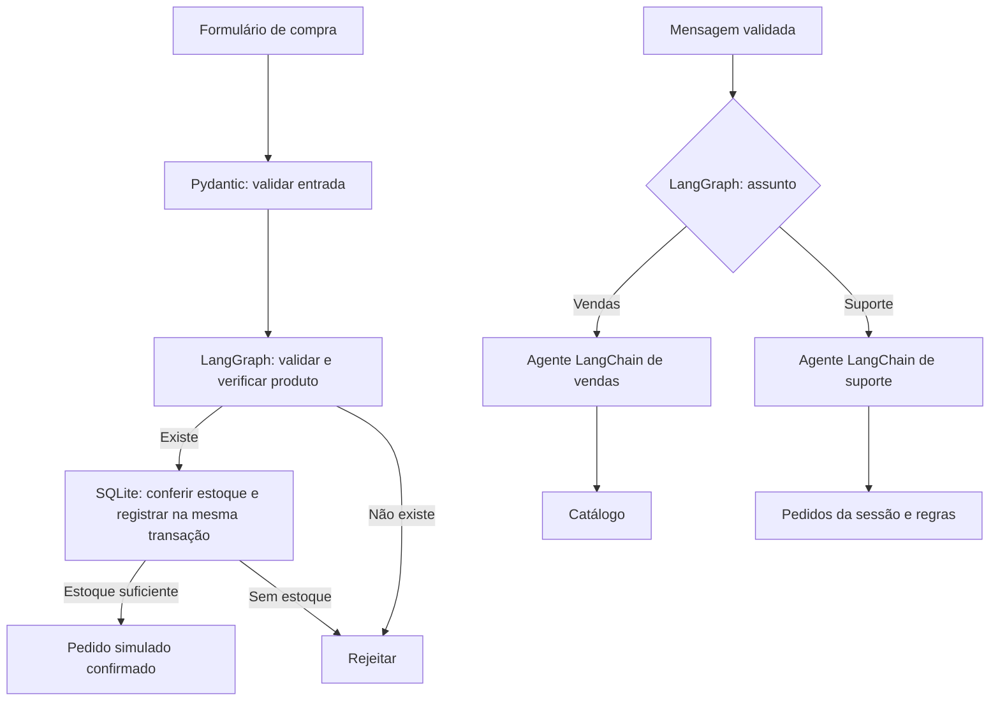

# Mercado Simples

Exemplo didático de um site de vendas inspirado no Mercado Livre. Python no
servidor e HTML/CSS/JavaScript no navegador, sem framework de frontend.
Inclui catálogo, compra simulada, pedidos por sessão e chat de atendimento.

## Rodar

Requer Python 3.11 ou superior. Na pasta do projeto:

```bash
python3 -m venv .venv
source .venv/bin/activate
pip install -r requirements.txt
cp .env.example .env
uvicorn main:app --reload --host 127.0.0.1 --port 8000
```

Abra http://127.0.0.1:8000. A documentação da API está em
http://127.0.0.1:8000/docs. No Windows, ative com `.venv\Scripts\activate`.

O modo padrão é `demo`: funciona sem chave, com respostas fixas identificadas
como demonstração. Os grafos LangGraph continuam sendo executados normalmente.
Nenhum valor é cobrado. Use dados fictícios, por exemplo Maria Exemplo,
`maria@example.com`, CEP `60000-000`.

## Ativar os agentes de IA

Edite o `.env` e reinicie o servidor:

```dotenv
CHAT_MODE=deepseek
DEEPSEEK_API_KEY=sua_chave_aqui
DEEPSEEK_MODEL=deepseek-flash
```

Nesse modo, o DeepSeek atende os dois agentes reais criados por
`langchain.agents.create_agent`. O pacote `langchain-openai` é usado como adaptador
porque a API DeepSeek é compatível com esse protocolo; o endereço configurado
é `https://api.deepseek.com`, e as chamadas vão ao DeepSeek:

- **Vendas:** ferramenta de consulta ao catálogo.
- **Suporte:** ferramentas de consulta aos pedidos da sessão e regras da loja.

O LangGraph escolhe o agente pelo assunto selecionado no chat, sem uma chamada
extra a um modelo para decidir algo que o usuário já informou. A conversa e
resultados de ferramentas são enviados ao provedor de IA; a ferramenta de
pedidos não retorna nome, e-mail ou CEP. Chamadas ao provedor podem ter custo.
A chave permanece no servidor. Falhas retornam HTTP 503, sem resposta simulada
silenciosa. Os agentes nunca têm ferramenta de efetuar compra.

## Por onde ler o código

| Arquivo | Responsabilidade |
|---|---|
| `specs/01-marketplace.md` | Regras e critérios de aceitação, escritos primeiro |
| `models.py` | Validação Pydantic das entradas |
| `store.py` | Catálogo e pedidos em SQLite |
| `agents.py` | Agentes LangChain e ferramentas de leitura |
| `flows.py` | Dois fluxos de negócio LangGraph |
| `main.py` | Rotas FastAPI e memória do chat por sessão |
| `static/` | Página, estilos e interações do navegador |
| `tests/test_app.py` | Cenários de aceitação automatizados |



`StateGraph` recebe um estado compartilhado. Cada nó é uma função que devolve
os campos que deseja atualizar; as arestas indicam qual função vem depois.
No fluxo de compra, não é necessário usar IA para validar estoque ou preço.

## Desenvolvimento guiado por especificações

O pipeline de desenvolvimento é **especificação → cenário de teste → código →
verificação**. Para mudar uma regra, primeiro altere seu critério em `specs/`,
depois o teste correspondente e por último o código. Os testes fazem referência
aos IDs CAT, VAL, BUY, CHAT e DATA. UI-01 é verificado no navegador.

```bash
pytest -q
```

Os testes usam um banco temporário, sem chamadas pagas. Cobrem entradas
inválidas, total, estoque concorrente, reenvios, isolamento entre sessões,
persistência, roteamento do chat, histórico e falha do provedor. A construção
dos agentes usa a API real do LangChain; respostas remotas são substituídas
por um fake nos testes. Isso não valida a qualidade de respostas de um LLM real.
O GitHub Actions executa esses mesmos testes em cada push e pull request,
sem precisar da chave DeepSeek.

`requirements.txt` define intervalos compatíveis; `requirements.lock.txt`,
quando presente, registra as versões usadas na verificação. Para reproduzi-las,
use `pip install -r requirements.lock.txt`.

## Limites intencionais

Este é um protótipo local para estudo, não uma plataforma pronta para produção.
Há compra de um produto por vez; não há login, vendedores ou pagamento real.
O banco `mercado.db` é criado automaticamente e preserva pedidos e estoque.
O identificador de tentativa torna o reenvio da mesma compra idempotente.
Dinheiro é armazenado em centavos, e estoque é atualizado atomicamente.

O cookie HttpOnly identifica a sessão do navegador por 24 horas. Apagar esse
cookie perde o acesso aos pedidos anteriores pela interface. O histórico do
chat fica em memória, com até 10 mensagens por sessão e 1000 sessões; reiniciar
o processo apaga esse histórico. Execute um único processo nesta versão.
Chamadas de chat simultâneas na mesma sessão não são uma experiência suportada;
a interface bloqueia um novo envio enquanto aguarda a resposta.

Antes de produção: implementar autenticação/autorização, HTTPS e cookie Secure,
limites de uso, política de dados, memória compartilhada e pagamentos reais.
O servidor guarda os dados fictícios do formulário no SQLite, mas não os exibe
nas ferramentas do chat. Não publique o banco ou o `.env`.

## Referências oficiais

- [Agentes LangChain](https://docs.langchain.com/oss/python/langchain/agents)
- [StateGraph e arestas LangGraph](https://docs.langchain.com/oss/python/langgraph/graph-api)
- [Validação Pydantic](https://docs.pydantic.dev/latest/concepts/validators/)
- [API compatível do DeepSeek](https://api-docs.deepseek.com/)
